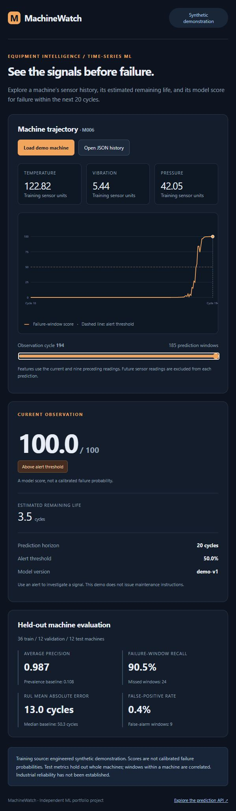

# MachineWatch

MachineWatch shows how sensor readings can help flag equipment that may fail soon. Use the dashboard to inspect changes in temperature, vibration, and pressure and explore maintenance decisions with simulated data.

An independent time-series ML project for predicting failure windows and remaining
useful life from temperature, vibration and pressure readings. A FastAPI service
and dashboard show risk scores, sensor trajectories, model versions and evaluation.

The default data is **engineered synthetic run-to-failure data**, not recorded
equipment failures, a physics simulation, or NASA data. Its metrics demonstrate
the pipeline and do not establish industrial performance or safety.

## Run locally

From this project's directory, with Python 3.12:

```powershell
python -m venv .venv
.\.venv\Scripts\Activate.ps1
pip install -r requirements-dev.txt -c requirements-lock.txt
python -m machinewatch.train --output artifacts/demo-v1
python -m uvicorn machinewatch.service:app --host 127.0.0.1 --port 8002
```

Open http://127.0.0.1:8002 for the dashboard and `/docs` for the API.
Load the held-out demo machine, move the cycle slider and inspect its risk trend.
The dashboard can also load your JSON history (`machine_id` plus `history`, each
reading containing `cycle`, `temperature`, `vibration`, `pressure`). The dashboard
sends the history to the local API for a trajectory; each prediction uses only its
ten-reading window. Histories must have increasing positive integer
cycles and finite sensor values. The service retains no uploaded history.

## What the experiment measures

- Seeded 60/20/20 splits hold out **whole machines**. All windows from a machine
  stay in one group. Rolling features use only the current and preceding readings.
- Failure label: the machine fails within the next 20 cycles, including the final
  cycle. RUL label: terminal failure cycle minus observation cycle.
- Classifier comparison: prevalence baseline, scaled logistic regression and
  histogram gradient boosting. Validation average precision selects the model.
- RUL comparison: median baseline, scaled ridge regression and gradient boosting.
  Validation MAE selects the model independently.
- Selected models are evaluated on test machines once. Reports include AP, ROC
  AUC, Brier score, precision/recall, false alarms, missed failure windows, RUL
  MAE/RMSE, and high-confidence mistakes. Alert threshold is fixed at 0.5.

AP is used because pre-failure windows are relatively rare. Window-level scores
are correlated within each machine and should not be presented as independent
trials. Confidence intervals and machine-level alert burden are not yet measured.
The displayed score is not a calibrated failure probability. RUL predictions
outside the training distribution should not guide equipment operation.

Each new output directory preserves the dataset, machine split, metrics, selected
models, feature schema, checksums, package versions and a held-out demo trajectory.
Retraining refuses to overwrite an existing run. To select or roll back a release,
set `MACHINEWATCH_ARTIFACT` to its directory and restart the API. `/ready` returns
503 for absent artifacts; incompatible schemas, versions or checksums fail startup.
Joblib artifacts must come from trusted local training; checksums detect corruption
and do not make untrusted pickle files safe.

## Bring another dataset

```powershell
python -m machinewatch.train --csv data/completed-runs.csv --output artifacts/experiment-v1
```

CSV columns: `machine_id,cycle,temperature,vibration,pressure`. This command requires
at least ten **complete run-to-failure histories**. Do not use censored operating
machines as completed failures: their last observed cycle is not a failure label.
Cycle units, sensor units and operating conditions must match training and serving.
Missing readings/values need an explicitly designed preprocessing policy.

For a stronger follow-up experiment, adapt NASA's [C-MAPSS run-to-failure data](https://www.nasa.gov/intelligent-systems-division/discovery-and-systems-health/pcoe/pcoe-data-set-repository/)
using its documented sensor definitions, operating settings and official test RUL
labels. C-MAPSS is itself simulated data; its truncated test histories cannot use
the last observed cycle as the failure cycle. This project does not claim to have
trained or evaluated on C-MAPSS, and simply renaming its sensors is insufficient.

## Verification and container

```powershell
python -m pytest -q
docker build -t machinewatch .
docker run --rm -p 127.0.0.1:8002:8000 -e MACHINEWATCH_ARTIFACT=/models/demo-v1 -v "${PWD}/artifacts:/models:ro" machinewatch
```

Use the recorded scikit-learn version when reproducing or serving an artifact.
The container uses the recorded dependency constraints in `requirements-lock.txt`.
Regenerate and verify the lock when upgrading packages. No cloud infrastructure or billing is
created. The supplied workflow tests causal features, held-out groups, invalid
inputs, real model training/serving and checksum rejection, then builds the image.

## Next research steps

Evaluate on a documented real/simulated public benchmark, account for operating
regimes and censored histories, quantify calibration, measure machine-level false
alerts and warning lead time, and validate distribution shift before deployment.

See [scikit-learn metrics](https://scikit-learn.org/stable/modules/model_evaluation.html)
for definitions. This project is separate from Oracle and AIClassificationSystem.


